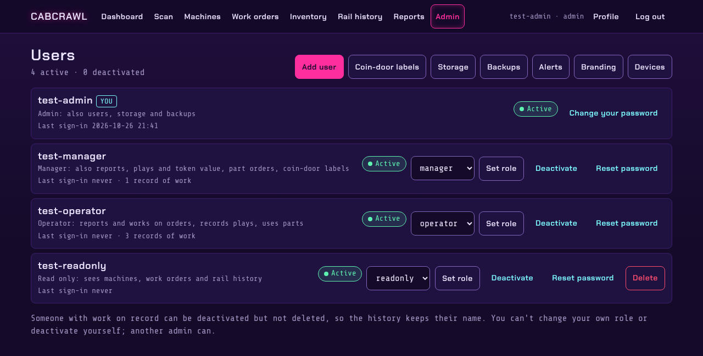
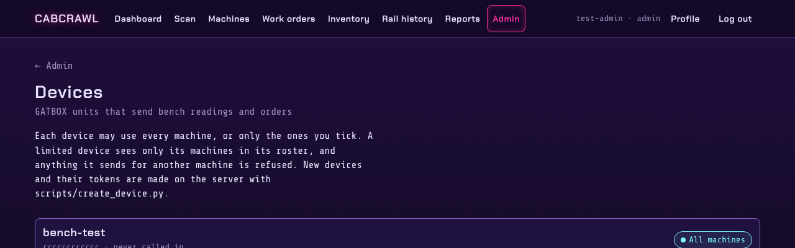
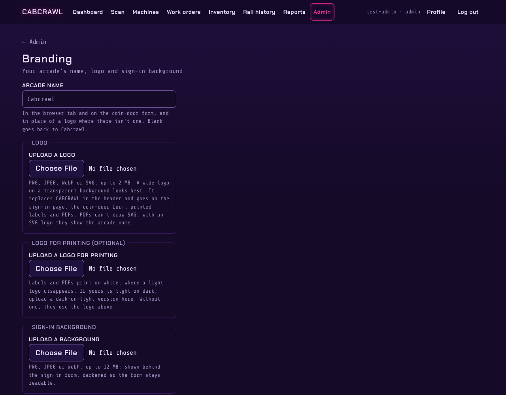

# Administration

The **Admin** menu is for admins only.

## Users

Create accounts, set each person's [role](Roles-and-Permissions), deactivate or delete them, and
reset a password. A new account and a reset both get a one-time password, shown to the admin once,
which the person must change when they first sign in. An admin can't remove the last admin, so
nobody can lock the app out of its own admin pages.

Deactivate rather than delete someone who has history: their work logs keep their name.

## Devices

A device is a GATBOX unit that sends rail readings and work orders to Cabcrawl over its API. Each
gets its own token, created with `scripts/create_device.py` on the server and shown once. A device
can send for every machine, or only the ones you tick; anything it sends for another machine is
refused. Untick **Enabled** to refuse everything from a device at once.

## Branding

Your arcade's own name and logo replace the CABCRAWL wordmark in the header. The name goes in the
browser tab and on the coin-door form; the logo also goes on the sign-in page, printed labels and
PDFs. A separate black-and-white logo can be used for printing, and a photo can sit behind the
sign-in form. An SVG logo is cleaned of anything that could run as a script.

"Runs on Cabcrawl" and the link to the source code stay in the footer, as the AGPL asks.

## Storage and backups

- **Storage** shows how much space work-order photos use against the limit, and can clear photos
  no work order uses any more.
- **Backups** of the production PostgreSQL database are taken by `deploy/deploy.sh` before every
  deploy, and by the server's own schedule; see `deploy/RUNBOOK.md`. The Backups page says where
  they are.
