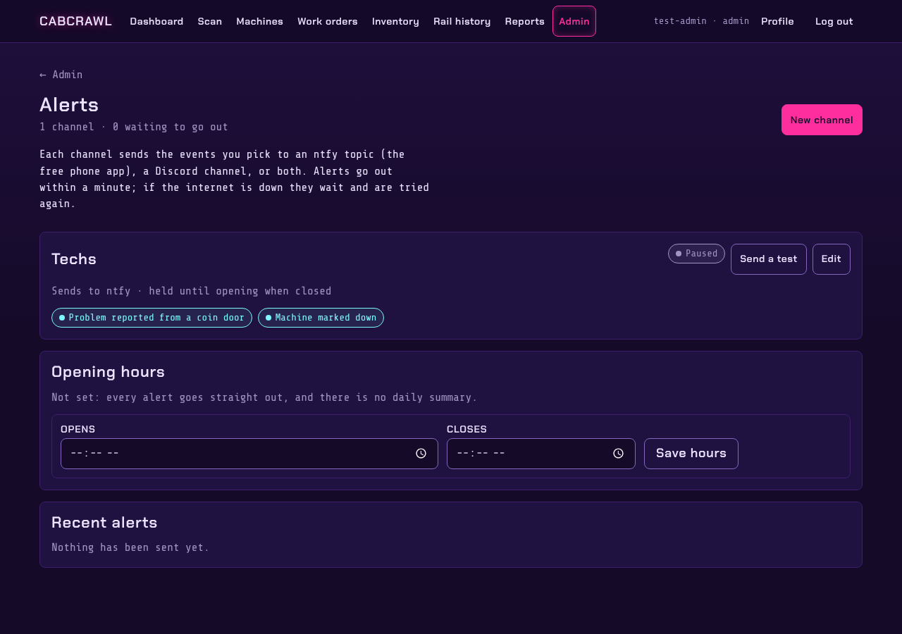

# Alerts

Alerts tell the right people about the things that need someone now. An admin sets them up under
**Admin → Alerts**.

## Channels

A channel sends the events you pick to an **ntfy** topic (the free phone app; you can run your own
ntfy server), a **Discord** webhook, or both. Make one channel per group: "Techs" for machines down
and coin-door reports, "Managers" for parts and the daily summary. **Send a test** checks a
channel before you rely on it.

## Events

| Event | When |
|---|---|
| Coin-door report | Someone reported a problem at the coin door |
| Machine down | A machine was marked Not working |
| Rail out of window | A GATBOX session didn't hold its window |
| Low stock | A part fell to or below its minimum |
| Maintenance due | A maintenance task opened a work order |
| Round flag | A collection-round reading was flagged: no plays since the last one, far more plays than usual, or a long gap |
| Part request | A requested part shipped or was received |
| Daily summary | Once a day, at opening |

## Opening hours

Set the arcade's opening and closing times. Outside them, a channel set to **hold** keeps its
alerts until opening and sends them as one message; any other channel sends straight away.
The daily summary goes out at opening.

## Delivery

Alerts are sent once a minute by a small job beside the app (`scripts/send_alerts.py`, run by the
`arcade-tracker-alerts.timer` systemd timer). A failed send is retried with growing gaps for a
day, then marked failed. The Alerts page lists what went out and what didn't.
