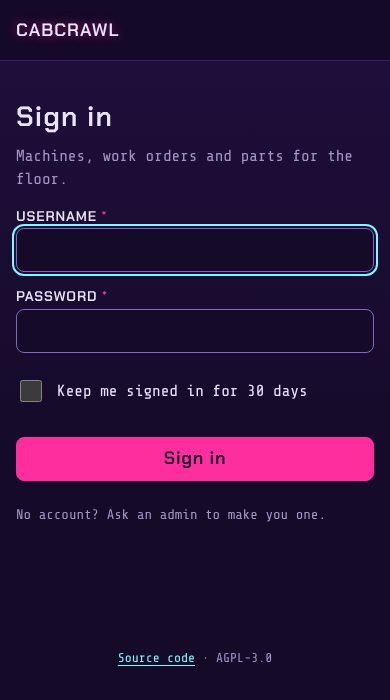

# Getting started

## Run it on your own machine

You need Python 3.11 or newer and git. SQLite is fine for trying it out; production uses
PostgreSQL.

```bash
git clone https://github.com/digitalunconciousness/cabcrawl.git
cd cabcrawl
python3 -m venv venv
. venv/bin/activate
pip install -r requirements.txt

cp .env.example .env
# Set SECRET_KEY in .env: 32 or more random characters, for example from
#   python3 -c "import secrets; print(secrets.token_urlsafe(48))"
# Without DATABASE_URL, the database is arcade.db (SQLite) in this folder.

set -a && . ./.env && set +a

# A new database: create the tables, then mark it as up to date with the migrations.
python -c "from app import create_app; from app.extensions import db; app = create_app(); app.app_context().push(); db.create_all()"
flask --app run:app db stamp head

python run.py                       # http://localhost:5000
```

From then on, after pulling a newer version, `flask --app run:app db upgrade` applies the new
migrations. (The migrations add to the schema; they can't build it from nothing, which is why a new
database starts with `create_all`.) `python scripts/check_schema.py` checks that the database
matches the code.

See [Configuration](Configuration) for every setting.

## First sign-in



On a new database, open `/setup` to create the first account. It's an admin, and its password must
meet the same strength rule as any other. After that, `/setup` is closed: an admin creates
everyone else under **Admin → Users**, each with a [role](Roles-and-Permissions).

If you're locked out, `scripts/create_admin.py` on the server lists accounts, creates an admin or
resets a password.

## Next steps

1. Add your machines (**Machines → Add machine**), or import a roster.
2. Set `BASE_URL`, then print a QR label for each cabinet.
3. Under **Admin → Branding**, add your arcade's name and logo.
4. Build your [places](Inventory#places) and add the parts you keep.
5. Set up [alerts](Alerts) so the techs hear about machines down.

## Production

Production runs under systemd behind a Cloudflare tunnel, with PostgreSQL. The repository's
`deploy/RUNBOOK.md` covers the first install, routine deploys (`deploy/deploy.sh`), backups and
restores, and what to check when something goes wrong.
