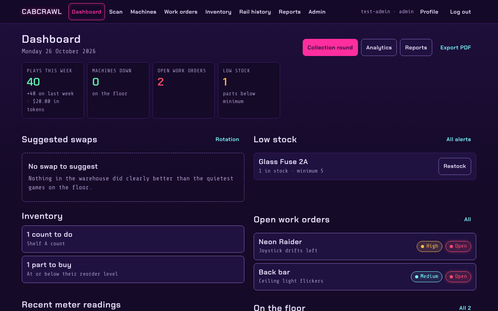

# CABCRAWL

**GATBOX tests the board. Cabcrawl runs the floor.**

Cabcrawl runs the arcade floor: where every machine is, what's broken and who's fixing it, which
parts are on the shelf, and what each cabinet earns. It's a web app for the people who keep an
arcade running, built to be used on a phone at the cabinet as much as on a desk.

## What it does

- **[Machines](Machines)**: the floor and the warehouse, a page per cabinet, QR labels, coin-meter
  rounds, and a rotation planner that suggests which games to swap.
- **[Work orders](Work-Orders)**: problems reported by staff or by players at the coin door, work
  logs, photos, parts used, and maintenance tasks that come due on their own.
- **[Inventory](Inventory)**: parts and where they are, counts, labels, requests, a shopping list,
  purchase orders, suppliers and serial-numbered units.
- **[Rail history](Rail-History)**: the power-rail readings GATBOX measures on each board.
- **[Reports](Reports)**: plays and token value, maintenance, PDFs and CSV exports.
- **[Alerts](Alerts)**: phone pushes through ntfy, and Discord, for the things that need someone now.
- **[Administration](Administration)**: users and roles, GATBOX devices, branding, storage.

## Setting it up

- [Getting started](Getting-Started): run it on your own machine, and the first sign-in.
- [Roles and permissions](Roles-and-Permissions): who can do what.
- [Configuration](Configuration): the settings in `.env`.
- [System architecture](System-Architecture) and [Security overview](Security-Overview).
- Running it in production: `deploy/RUNBOOK.md` in the repository.

Every screenshot in this wiki uses invented machines, parts and people.

Cabcrawl was called Arcade Tracker until October 2026. It is free software under the
[AGPL-3.0](License).
