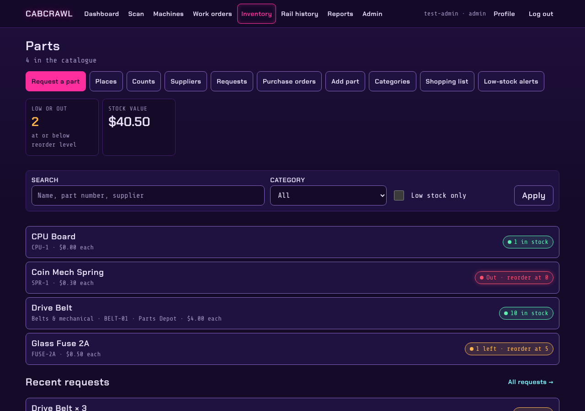
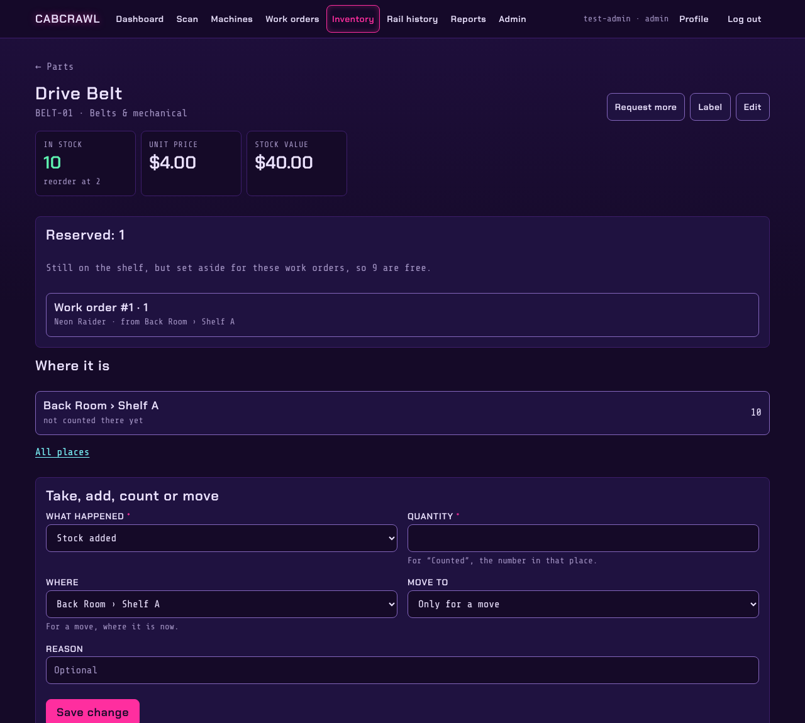
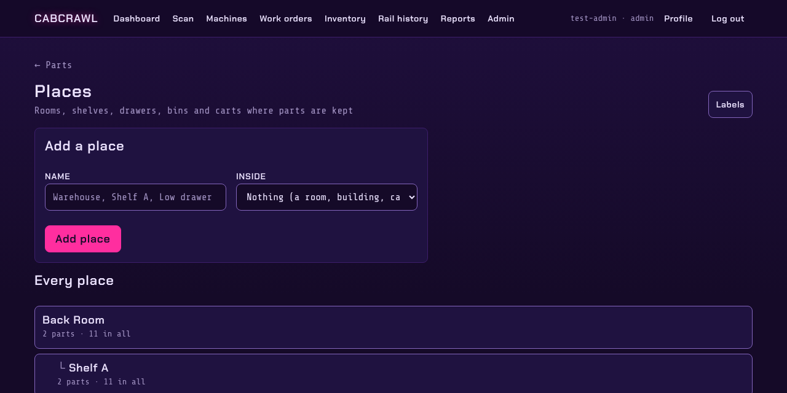
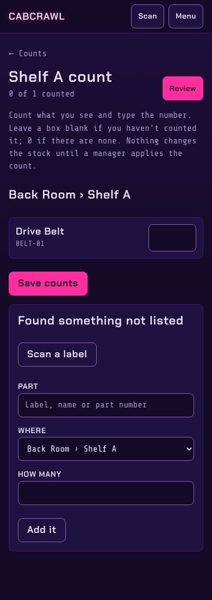
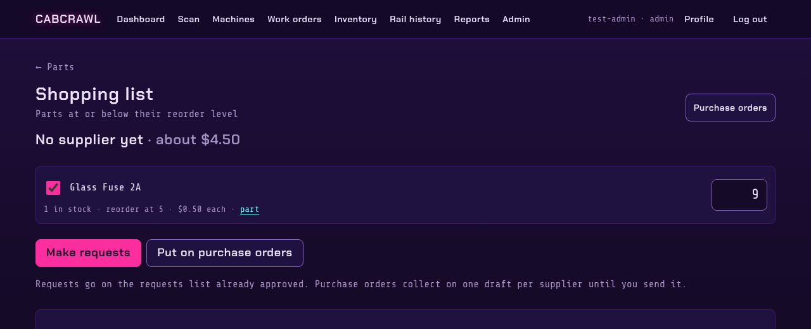
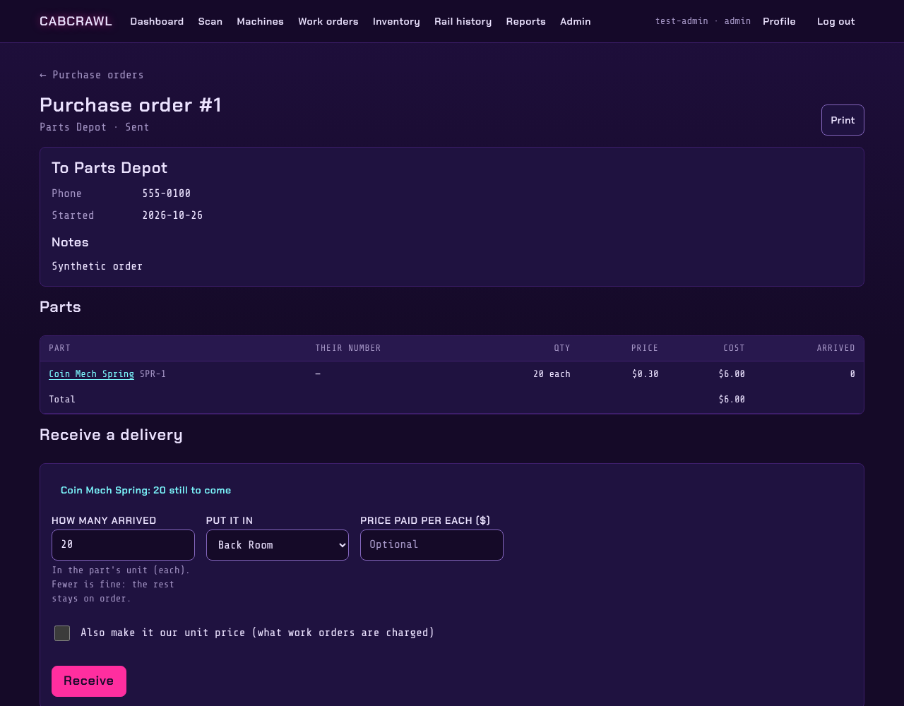

# Inventory

Parts, where they are, and getting more before they run out.

## Parts

**Inventory** lists every part with its stock, reorder level and value. Search by name, part
number or supplier, filter by category, or show only what's low.

A part's page says how many there are, how many are reserved for work orders, and **where they
are**, place by place. **Take, add, count or move** records every change, with who made it and
why:

- **Stock added** or **removed**, **used in a repair**, **damaged**, **returned to supplier**: in
  or out of one place.
- **Counted (set to)**: the number actually in that place.
- **Moved**: from one place to another.

The page also shows the part's details, its suppliers and prices, which machines it fits, and its
history.

## Places

Places are a tree you build to match the building: a room, the shelves in it, the drawers in a
shelf. Every place can have a label. Stock that hasn't been put anywhere yet is in **Unsorted**.
A place that's empty can be deleted; otherwise archive it.

## Counts

A count checks what's really on the shelves:

- **Full count**: every part in the places you pick, and the places inside them.
- **Cycle count**: a few parts at a time, the ones counted longest ago first. Repeated weekly, the
  whole stock gets counted without a big count day.

Count on a phone: type what you see, leave a box blank if you haven't counted it, and add anything
found that wasn't listed. A manager reviews the differences before they change the stock. You can
also count one place on the spot from its label.

## Requests, the shopping list and purchase orders

- **Requests**: anyone on the floor can ask for a part. Managers approve them, and the person who
  asked follows its progress, including shipment tracking when a tracking number is added.
- **Shopping list** (managers): everything at or below its reorder level, with reserved parts
  counted as needed, grouped by supplier, with a suggested quantity. Tick what to buy and turn it
  into requests, or into purchase orders.
- **Purchase orders** are optional; turn them on from the shopping list. Each supplier gets a
  draft order; send it, then receive deliveries line by line into a place.

Receiving a delivery puts the parts on the shelf, and can update the part's price. An operator can
receive their own requests; managers can receive anything.

## Suppliers, categories and serial units

- **Suppliers**: contact details, and each part's supplier part number, price and price history.
  Account numbers are shown to managers only.
- **Categories** group parts for filtering and the shopping list.
- **Serial units**: for parts tracked one by one (a CPU board, a monitor), each unit has its own
  label, state (in stock, in a machine, at repair, retired) and history.
