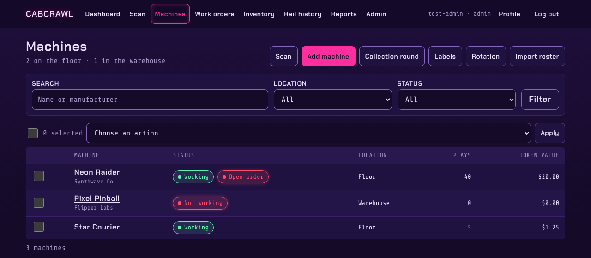
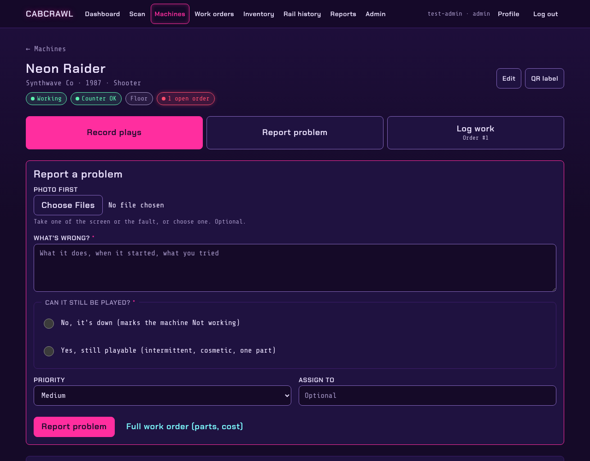
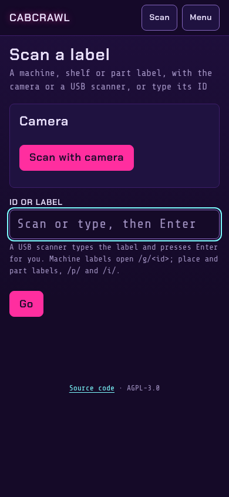
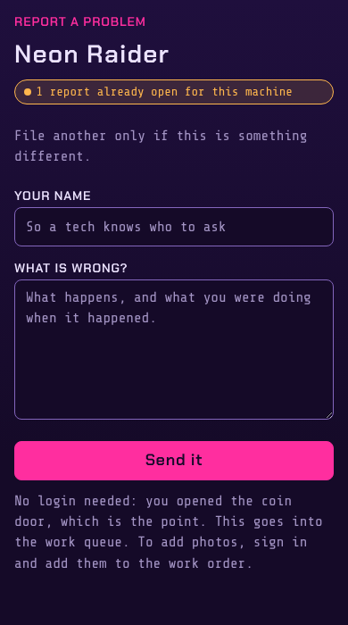
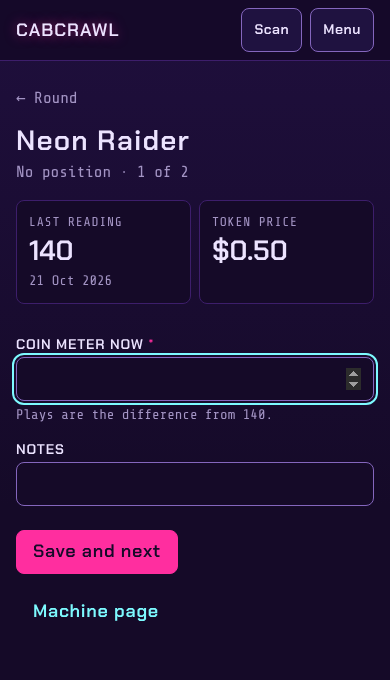
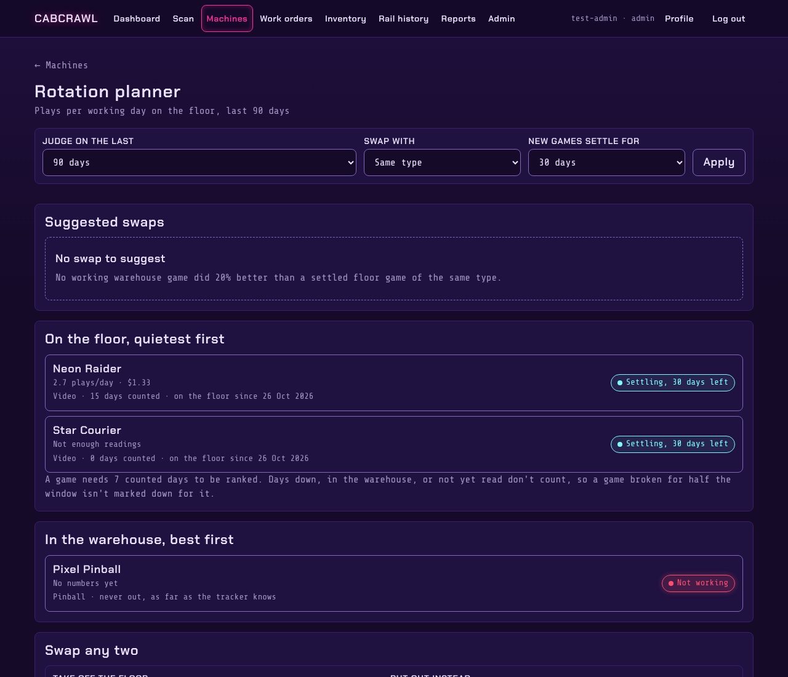

# Machines

Every cabinet has a page, a QR label, and a place on the floor or in the warehouse.

## The machine list

**Machines** lists every cabinet with its status, where it is, its plays and token value. Search by
name or manufacturer, or filter by location and status. Tick several to move them or change their
status together. From here: add a machine, start a collection round, print labels, open the
rotation planner, or import a roster.

## A machine's page

The page a QR label opens. The three big buttons are the jobs done at the cabinet:

- **Record plays**: type the coin meter; the plays are the difference from the last reading.
- **Report problem**: a photo first if you have one, what's wrong, and whether it can still be
  played. "No, it's down" marks the machine Not working.
- **Log work**: on the machine's open order.

Below: when it was last fixed and by whom, its open work orders, plays and token value over time,
the parts that fit it and the parts it has used, its rail readings, and its history of moves and
status changes.

## Labels and scanning

**Scan** opens the phone camera, or takes what a USB scanner types. Each label encodes an address
that never changes:

| Label | Address | Opens |
|---|---|---|
| Machine | `/g/<barcode>` | the machine's page |
| Place (shelf, drawer, bin) | `/p/<code>` | the place, with count mode a tap away |
| Part | `/i/<code>` | the part: where it is, take, add, count or move |
| Serial unit | `/u/<code>` | that one unit and its history |

Labels print on sheets from **Machines → Labels** and **Inventory → Labels**. Set `BASE_URL`
([Configuration](Configuration)) before printing, so labels carry the public address.

## Problem reports from the coin door

A **coin-door label** goes inside a cabinet's coin door. Anyone who can open the door can scan it
and report a problem without signing in; the report lands in the work queue as a work order and
can raise an alert. If the machine already has an open report, the form says so. Managers print and
retire coin-door labels from **Machines → Labels**.

## Collection round

**Collection round** walks the floor one machine at a time: type the coin meter, add a note, and
**Save and next**. It shows the last reading and the token price, and flags a reading with no plays since the last
one, far more plays than usual, or a long gap, so a misread stands out.

## Rotation planner

For arcades with more games than floor space (managers). It ranks floor games by plays per
working day, quietest first, and warehouse games best first, and suggests swaps where a warehouse
game did clearly better. Days a game was down, in the warehouse or not yet read don't count, and a
new game gets a settling period before it's judged. **Swap any two** moves both games and records
it in each one's history.
