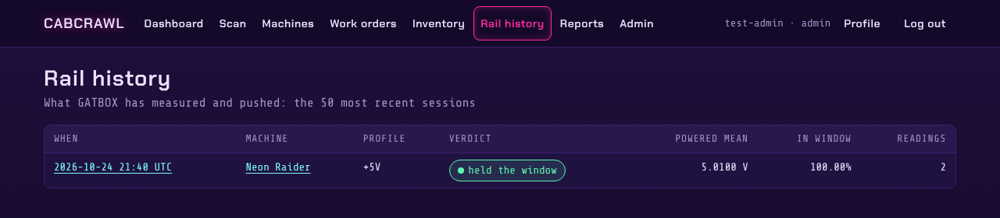
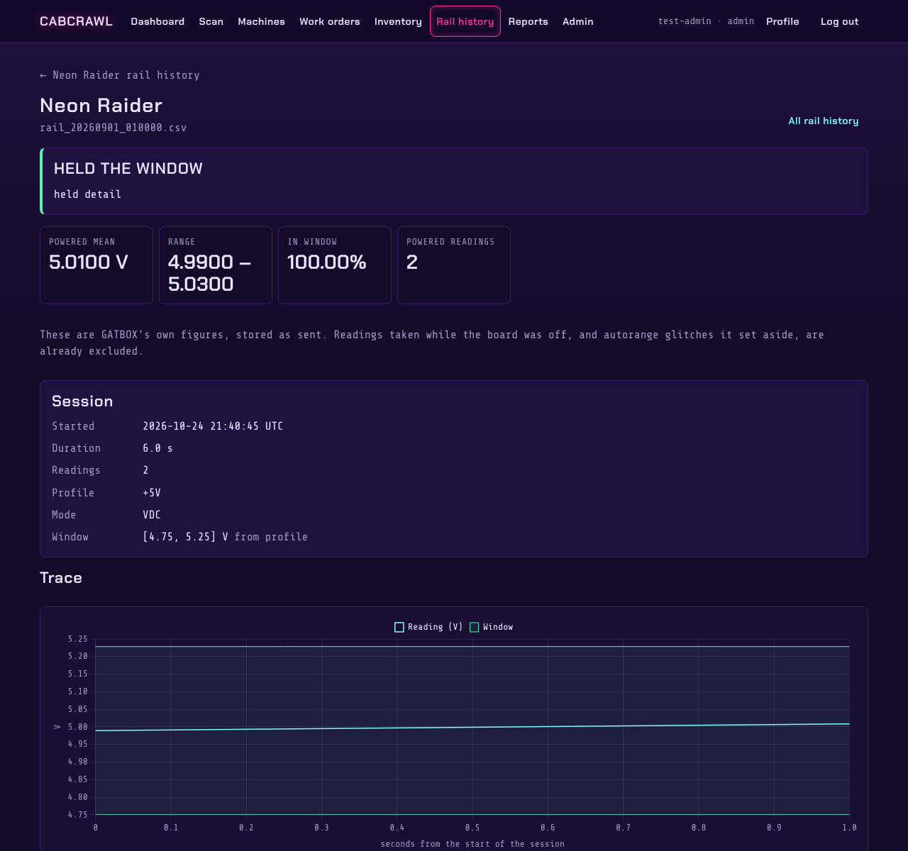

# Rail history

GATBOX is the bench tool that tests a board's power
rails. When it's connected to Cabcrawl as a [device](Administration#devices), each test session it
runs is sent here and kept against the machine.

**Rail history** lists the most recent sessions: when, which machine, which rail profile (+5V,
+12V...), whether it held the window, the mean voltage while powered, and the share of readings in
the window.

## A session

A session shows GATBOX's own verdict and figures, stored exactly as sent. Readings taken while the
board was off, and autorange glitches GATBOX set aside, are already excluded. Below that: the
session details, the trace against its window, and the readings themselves.

A reading can be **added to an open work order**, with a note ("after replacing the bridge
rectifier"), or used to **open a new work order** for the machine. Each machine's page links to
its own rail history, with a chart of every session against the window.

Everyone signed in can see rail history; it can't be edited.
