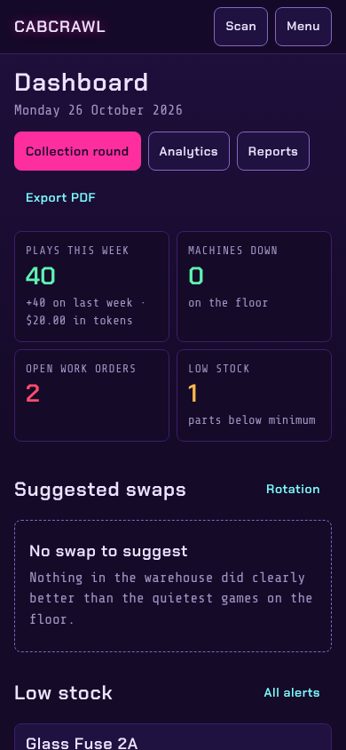
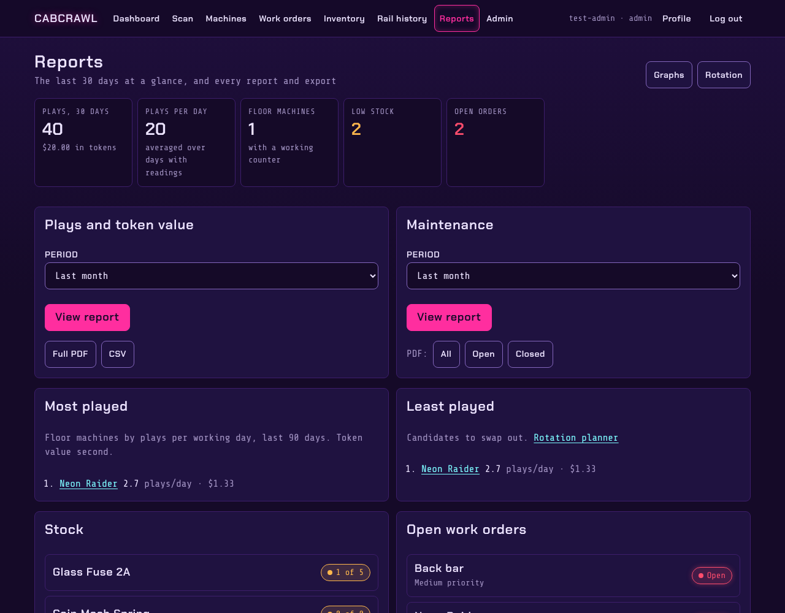
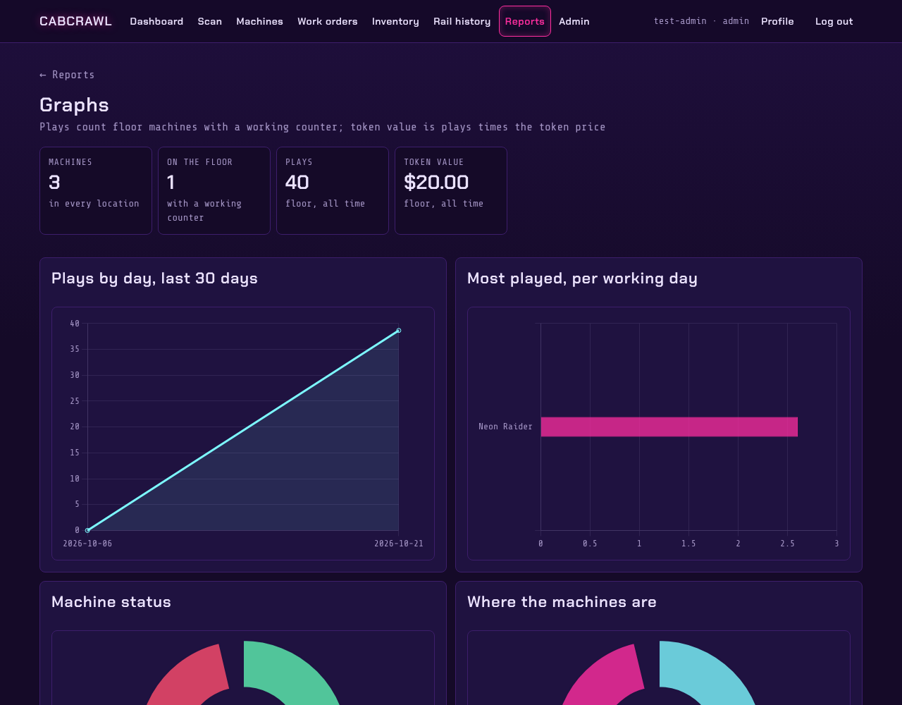

# Reports

## The dashboard

The first page after signing in: plays this week, machines down, open work orders and parts below
minimum, then suggested swaps, low stock, inventory to do (counts, parts to buy), open work
orders, recent meter readings and what's on the floor.

## Reports

**Reports** (managers) brings together the last 30 days: plays and token value, the most and least
played games, maintenance, stock and open orders. From here:

- **Plays and token value** over a period, on screen, as a PDF or as CSV.
- **Maintenance** over a period: orders opened and closed, by status.
- **Graphs**: plays by day, the most played games per working day, machine status and where the
  machines are.

## Exports

- **PDF**: the dashboard, the reports and each work order.
- **CSV**: every machine with its totals, or the machines you tick on the machine list. A cell that
  starts with `=`, `+`, `-` or `@` is written so a spreadsheet shows it as text, not a formula.

Rankings (times in the top 5 and top 10) update monthly.
