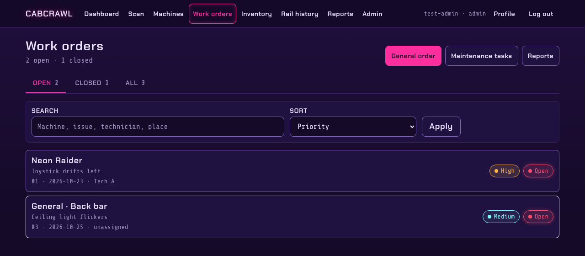
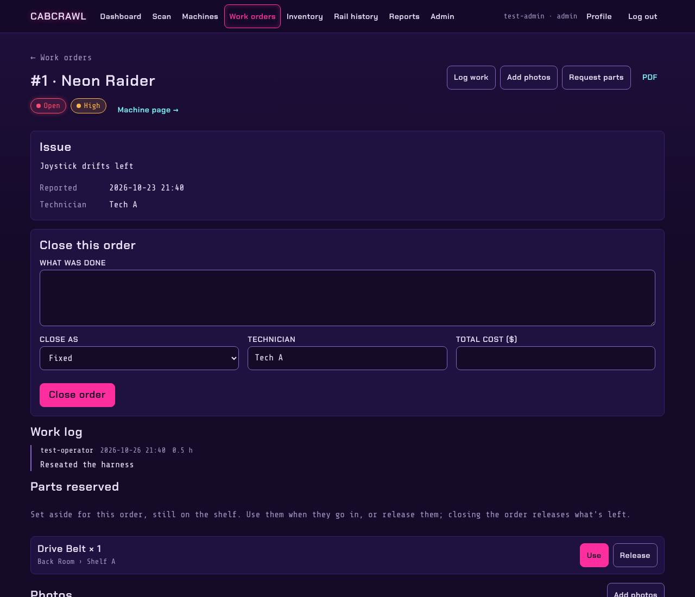
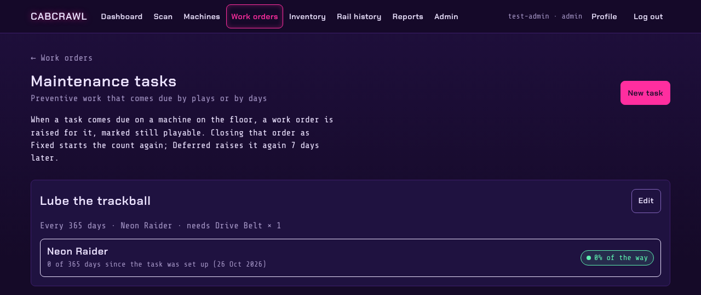

# Work orders

A work order is one problem with one machine (or a general job, like a ceiling light), from the
report to the fix.

## The list

**Work orders** shows open orders first, with priority and status. Search by machine, issue,
technician or place, sort by priority or date, or switch to closed orders.

Orders come from three places:

- staff reporting a problem on a [machine's page](Machines#a-machines-page);
- players or staff at the coin door, through a [coin-door label](Machines#problem-reports-from-the-coin-door);
- [maintenance tasks](#maintenance-tasks) that come due.

## An order

- **Log work**: what you did and how long it took. Each entry is kept with who wrote it and when.
- **Parts**: take a part from a place as it goes in, or **reserve** it. A reserved part stays on
  the shelf but is set aside for this order. **Use** it when it goes in, or **Release** it.
  Closing the order releases whatever wasn't used.
- **Add photos**: from the phone camera. Portrait photos are stored the right way up.
- **Request parts**: asks for something that isn't in stock (see [Inventory](Inventory#requests-the-shopping-list-and-purchase-orders)).
- **Rail readings**: a GATBOX reading can be attached as evidence (see [Rail history](Rail-History)).
- **Close**: what was done, Fixed or another outcome, the technician and the total cost.
- **PDF**: the order, its log and parts, for the file.

Delete an order only if it was raised by mistake; otherwise close it.

## Maintenance tasks

Preventive jobs that come due by themselves: clean the trackball every 90 days, swap the buttons
once a year. A task applies to one machine, to every machine, or only to the pinball or the video games.
When it's due on a machine on the floor, a work order opens on its own, reserving the parts the task needs. If some of them aren't
in stock, the order says how many are short. Managers create and edit tasks; everyone can see
what's due.
